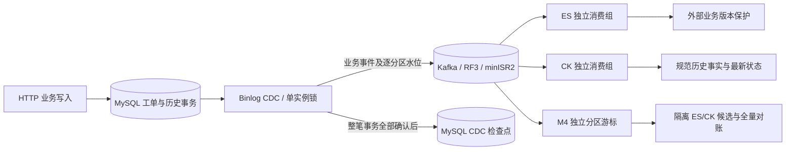

# TicketPulse M4-02：Kafka 多副本与 Broker 故障恢复

本轮验证 Kafka 消息层的多副本、Leader 切换、消费者重平衡与恢复。结论为 **PROCESS_FAILOVER_VERIFIED**：同一台 Mac 上的 Kafka 4.4 三个独立进程通过了真实故障矩阵，已确认消息完整保留，恢复后 MySQL、ES 和 CK 一致。主机、磁盘、网络及其他 TicketPulse 组件的生产高可用不在这一结论内。

调查以本轮开始时的 live repository 为准。源码基线有 219 个文件，保存在 [基线归档](../artifacts/m4-02/pre-m4-02-source.tar.gz) 与 [哈希清单](../artifacts/m4-02/baseline-source-manifest.json)。仓库没有已有提交，普通 git diff 无法表示这些未跟踪文件的增量，因此交付 [完整 Diff](../artifacts/m4-02/full.diff) 以该归档为基准，并实际应用到临时目录逐字节核对。

## 验收结果

以下数字来自 [原始结果汇总](../artifacts/m4-02/matrix-summary.json)；每项均可沿原始时间线和分区记录复核。

| 判断 | 实测依据 |
| --- | --- |
| 单 Broker 失效后能够继续发布与消费 | 分区 Leader 硬杀后 12.02 秒观察到新 Leader，12.28 秒下一业务消息取得确认，14.82 秒两个消费组追平 |
| 已确认消息没有丢失或内容改变 | 最终逐条验证 176 条观察到的 ACK 对应 Offset 与消息 SHA-256；保留的原始分区记录位置连续 |
| 两节点失效时不提前推进 CDC | 同事务第一个事件确认后杀掉两个节点；12.44 秒明确返回未确认，检查点始终为 13705246，小于事务提交位置 13734985 |
| 最小 ISR 确实阻止确认 | 控制器多数派仍可用的单独对照中，ISR=1、minISR=2，Broker 三次记录 NotEnoughReplicasException，生产者没有成功 ACK |
| 恢复能够追平并完整对账 | 两节点重启后 24.22 秒恢复 ISR=3 和两组追平；28 张工单、120 条规范历史、122 条 CK 物理历史，差异为 0 |
| 下游重放保留原业务合同 | ES 新版本 12 未被未提交的 11 覆盖；CK 同版本物理行 1→2、规范事实仍为 1；迟到旧版本后当前版本为 14 |
| M4 保持独立分区进度 | Broker 故障后同一重建任务恢复为 completed/consistent，三分区确认相同源标记，两个实时消费组的提交位置没有被重建改动 |

完整 A–J 矩阵由五个真实集成测试覆盖，最终全部通过，见 [矩阵原始日志](../artifacts/m4-02/matrix/verified/faults.log) 和 [测试清单](../artifacts/m4-02/matrix/verified/test-summary.json)。最终配置读取修正另有 [定向验收](../artifacts/m4-02/matrix/final-readiness-contract/faults.log)。M1/M2/M3/M4/M5 相关集成回归为 89 PASS、0 FAIL，单元、race、vet、Python 测试也均通过。

## 真实消息链路与源码依据

业务 HTTP 写入只提交 MySQL 当前工单和同版本历史，不等待 Kafka。CDC 在事务提交边界把工单与历史组成事件，生产确认后才能保存捕获检查点。ES 和 CK 分别消费同一 Topic，各自执行下游写入、持久化处置结果，然后提交本分区的下一 Offset。



源码副本包含行号：[原实现](../artifacts/m4-02/source/original/internal/syncpipe/queue.go)、[最终 Kafka 实现](../artifacts/m4-02/source/final/internal/syncpipe/queue.go)、[CDC](../artifacts/m4-02/source/final/internal/syncpipe/capture.go)、[ES 消费](../artifacts/m4-02/source/final/internal/syncpipe/consumer.go)、[CK 消费](../artifacts/m4-02/source/final/internal/syncpipe/analytics_consumer.go)。下表说明判定时真正使用的合同。

| 环节 | 当前实现与约束 | 源码 |
| --- | --- | --- |
| 多 bootstrap | 原来已支持逗号分隔；捕获、两组消费者和重建 tail 都传入同一 seeds 列表 | queue.go 的 ConnectQueue/NewQueue/ConsumerClient；rebuild_tail.go 的 tailClient |
| Producer | acks=all，franz-go v1.20.1 默认幂等；工单 ID 为 Key；RecordRetries=5、记录期限 10 秒、请求期限 3 秒、额外等待 2 秒；缓冲 1000 条/8 MiB | queue.go；replication_test.go |
| CDC 检查点 | XID/COMMIT 后按顺序发布全部业务事件，再确认这一事务的分区水位；全部成功才 SaveCheckpoint。失败从持久检查点重放，允许已发布事件重复 | capture.go 的 committed 闭包 |
| Topic 身份 | MySQL 保存 Topic 名、UUID 和分区数；同名新 Topic 拒绝接续，不自动从头或末尾重置 | kafka_identity.go；008_kafka_sync.sql |
| 消费 Offset | ES/CK 使用不同组；DisableAutoCommit、BlockRebalanceOnPoll；批次 16，分区并行、分区内顺序；下游处置成功后 CommitRecords，提交限时 8 秒，批次限时 45 秒 | queue.go 的 Consume；两个 Consumer.Run |
| 错误恢复 | 永久无效事件持久隔离；暂时下游失败只暂停失败分区，默认退避 2 秒；提交、进度或组会话失败退出当前运行，由 CLI 监督器退避 2 秒重启。身份/源不兼容明确终止 | linkerrors/errors.go；retry.go；cmd/ticketpulse-sync/main.go 的 supervise |
| M4 标记 | 冻结 Topic UUID 和每分区起点；每条记录必须等于 next_offset；应用后保存 next_offset。所有分区确认同一源标记再对账，不提交实时消费组 Offset | rebuild_snapshot.go；rebuild_tail.go；rebuild_target.go |

ES 使用严格 external version，旧版和同版不能覆盖新版。CK 允许相同业务版本出现多条物理行，统计和对账按组织/工单/版本归并；首次解决只取首次，当前状态取最新有效版本，同键内容冲突必须显式失败。M4、CK 统计 SQL、业务 DDL、搜索授权和页面代码未改动。

## 本轮改动与依据

原代码创建 Topic 固定为 RF1/minISR1。多个 seeds 并不能改变这件事。本轮增加显式部署配置，默认仍保持原演示 1/1：

| 配置 | 默认 | 本轮主链路 |
| --- | --- | --- |
| TICKETPULSE_KAFKA_BROKERS | 原演示地址 | 127.0.0.1:19094,127.0.0.1:19096,127.0.0.1:19098 |
| TICKETPULSE_KAFKA_PARTITIONS | 3 | 3 |
| TICKETPULSE_KAFKA_REPLICATION_FACTOR | 1 | 3 |
| TICKETPULSE_KAFKA_MIN_INSYNC_REPLICAS | 1 | 2 |

配置范围为副本数 1–64、最小 ISR 1–副本数。启动逐分区核对实际副本数，并核对 Topic 最小 ISR、保留策略和禁用不干净选举。新 Topic 创建确认可能早于 Broker 元数据/配置传播，因此两阶段都只对“Topic 尚未可见”做有界等待；真实分区、副本和配置不匹配仍立即拒绝。不会自动重分区、重分配副本或修改已有 Topic 的持久性。

两节点硬杀发现原同步生产调用存在实际等待问题。虽然外层 context 为 12 秒、记录期限为 10 秒，franz-go 在已发出请求且幂等结果不明时会延后记录超时，以保护序列；原 `ProduceSync` 等待 callback，超过 25 秒仍没有向 CDC 返回。失败原始证据保留在 [修正前日志](../artifacts/m4-02/matrix/boundary-corrected/faults.log) 和 [时间线](../artifacts/m4-02/matrix/boundary-corrected/faults/TestM402ReplicaFaultMatrixAtoEAndH/timeline.jsonl)。

最终发布使用原客户端的异步回调，只把“实际确认完成”和“调用截止”分开等待。截止后返回未确认，不终止幂等序列、不宣称消息未写入、不保存检查点；回调可以迟到，缓冲通道不会阻塞。恢复时重读原检查点，旧请求与重放都可能成为物理消息，ES/CK 继续依赖原业务版本保护。 [修正后的结果](../artifacts/m4-02/matrix/verified/faults/TestM402ReplicaFaultMatrixAtoEAndH/D-result.json) 证明整个部分确认事务停在原检查点。

测试只增加精确的独立 MySQL socket 白名单、私有 CLI 二进制路径，以及隔离故障执行器。原 ES 进度失败回归现在先停捕获、排空每个分区，再停直接消费者；故障触发器仅拦截目标工单版本的处置写入，避免周期水位先触发同一个测试故障。生产消费逻辑、重建协议和下游模型未因这个测试调整而改变。

## 隔离环境与复制配置

Mac 为 arm64、48 GiB 内存、18 个逻辑 CPU。三个 Kafka 4.4.0 进程各自具有数据目录、元数据目录、日志和端口，Java 堆为 128–512 MiB。Kafka/JDK 复用校验过的发行包，只读使用，见 [发行包哈希](../artifacts/m4-02/environment/distributions.json)。

| 组件 | 私有端口 | 私有资源/身份 |
| --- | --- | --- |
| Broker+Controller 401 | 19094 / 19095 | node-401 独立 data/metadata/logs |
| Broker+Controller 402 | 19096 / 19097 | node-402 独立 data/metadata/logs |
| Broker+Controller 403 | 19098 / 19099 | node-403 独立 data/metadata/logs |
| MySQL 8.4.5 | 33310 | 新实例 UUID；64 MiB buffer pool，最多 64 连接 |
| ES 8.17.5 | 19204 / 19304 | 独立数据目录、512 MiB 堆 |
| CK 26.10.2.103 | 18127 / 19005 | 独立数据目录，4 GiB 服务内存限制 |
| HTTP | httptest 的本机随机端口 | 使用真实路由、认证、事务和业务服务；没有修改 18080 演示应用 |

集群 UUID 为 `n74SC1N8QqW8KcQ8EK7tFw`。KRaft 使用三个动态 voting controller，format 时指定相同的 initial controllers 与各自目录身份。原始配置分别保存在 [401](../artifacts/m4-02/environment/kafka/node-401/server.properties)、[402](../artifacts/m4-02/environment/kafka/node-402/server.properties)、[403](../artifacts/m4-02/environment/kafka/node-403/server.properties)。[Quorum 状态](../artifacts/m4-02/matrix/verified/faults/TestM402ReplicaFaultMatrixAtoEAndH/A-baseline-quorum.json) 与 [复制位置](../artifacts/m4-02/environment/kafka/quorum-replication-after-matrix.txt) 记录实际投票成员和元数据高水位。

业务 Topic 为三分区、RF3/minISR2。内部 `__consumer_offsets` 也是三分区、RF3，每分区实测 ISR3，minISR2、compact、禁用不干净选举；见 [内部 Topic 元数据](../artifacts/m4-02/matrix/verified/faults/TestM402ReplicaFaultMatrixAtoEAndH/offsets-topic-metadata.json) 和 [实际 Topic 配置](../artifacts/m4-02/matrix/verified/faults/TestM402ReplicaFaultMatrixAtoEAndH/A-baseline.json)。事务状态日志配置 RF3/minISR2；本链路采用幂等生产者，未开启 Kafka 事务，不宣称执行过事务 Topic 故障验收。

Kafka 4.4 的 Offset 提交可靠性不能只靠配置文本证明。配置文件写了 `offsets.commit.required.acks=-1`，DescribeConfigs 将它作为 sensitive static entry 返回 null，本轮不把这项 null 当已核实生效。对固定发行包的 [协调器字节码](../artifacts/m4-02/environment/kafka/bytecode/CoordinatorRuntime$CoordinatorContext.txt) 与 [高水位完成处理](../artifacts/m4-02/environment/kafka/bytecode/CoordinatorRuntime$HighWatermarkListener.txt) 另外确认：写入使用 -1，操作加入 deferred queue，复制高水位推进后才 completeUpTo。实际组 Offset 在 Broker 故障恢复后也保持正确。

安全预算为私有运行目录 8 GiB、Kafka 总 RSS 6 GiB、可用磁盘至少 20 GiB。共保存 511 个两秒间隔采样点，观测峰值为私有目录 2.03 GiB、Kafka RSS 1.27 GiB；`ps` CPU 合计最高 473.4%，其口径为每进程移动平均，100% 约一个逻辑 CPU。没有达到停止预算。原始 [资源采样](../artifacts/m4-02/resources) 和 [汇总](../artifacts/m4-02/resource-summary.json) 保留。首个采样器在 CK 临时目录删除竞争时退出，15:37:56Z–15:46:13Z 有明确缺口，因此峰值仅是已采样时点的峰值；各执行阶段也单独记录资源预算。

## 故障矩阵与恢复时间线

故障命令先校验集群 UUID、私有配置和固定 JDK，再操作本轮节点。保留的时间线只记录请求类型、状态、工单 ID/版本、分区位置、消息哈希和错误，没有 Cookie、Bearer、凭据或工单正文。原始业务导出单独用于本地合成夹具的全字段对账。

| 场景 | 真实注入与观察 | 证据入口 |
| --- | --- | --- |
| A | 十工单 Gold 加真实 HTTP 创建/认领/处理/解决，三个分区双消费组追平 | [初始状态](../artifacts/m4-02/matrix/verified/faults/TestM402ReplicaFaultMatrixAtoEAndH/A-baseline.json) |
| B | ACK 后 SIGKILL 该分区 Leader 402；新 Leader 403，继续写入，所有分区 ISR2，双组零积压 | [结果](../artifacts/m4-02/matrix/verified/faults/TestM402ReplicaFaultMatrixAtoEAndH/B-result.json) |
| C | 停止选定分区 Follower 402，其 Leader 403 保持；继续五套真实 HTTP 创建/动作，7.62 秒完成该批写入和追平 | [Follower 状态](../artifacts/m4-02/matrix/verified/faults/TestM402ReplicaFaultMatrixAtoEAndH/C-follower-dead.json) |
| D | 同一 MySQL 事务更新两个工单；第一个 v2 ACK 后 SIGKILL 401/402；第二个未确认，检查点不动；故障期间 HTTP 创建仍返回 201 | [检查点与错误](../artifacts/m4-02/matrix/verified/faults/TestM402ReplicaFaultMatrixAtoEAndH/D-result.json) |
| D 对照 | 独立 RF2/minISR2 Topic，杀一个 Follower，保持两个 Controller 可用；ISR1 导致真实 Broker 拒绝 | [Broker 拒绝日志](../artifacts/m4-02/matrix/verified/faults/TestM402MinISRWithControllerQuorumAvailable/broker-minisr-errors.json) |
| E | 原目录/节点恢复，CDC CLI 从旧检查点重启，积压追平；两条业务 v2 最终有四条物理 Kafka 消息 | [事务重放](../artifacts/m4-02/matrix/verified/faults/TestM402ReplicaFaultMatrixAtoEAndH/partial-transaction-replay.json) |
| F | MySQL trigger 阻断 ES v11 写成功后的处置更新；Offset 留在该记录之前；先写入真实 v12 再恢复消费者，v11 被判 duplicate_or_old | [结果](../artifacts/m4-02/matrix/verified/faults/TestM402DownstreamWriteBeforeOffsetAndVersionReplayFG/F-result.json) |
| G | CK 两表 v13 已写后处置失败；Offset 未过该记录；写 v14、恢复、注入旧版/重复事件，物理 v13 1→2，规范为 1、当前 14 | [结果](../artifacts/m4-02/matrix/verified/faults/TestM402DownstreamWriteBeforeOffsetAndVersionReplayFG/G-result.json) |
| H | Broker 恢复期间增加 ES/CK 各第二个真实 CLI 实例，两个组 Stable 且均为两成员；逐条分区处置记录核对无遗漏 | [两成员与 Offset](../artifacts/m4-02/matrix/verified/faults/TestM402ReplicaFaultMatrixAtoEAndH/H-two-members-recovered.json) |
| I | 仅删除并重建自己的随机 Topic，同名新 UUID；CDC/ES/CK 启动与 M4 接续全部拒绝，检查点相等 | [身份拒绝](../artifacts/m4-02/matrix/verified/faults/TestM402TopicIdentityChangeRejectedI/I-result.json) |
| J | M4 冻结快照后继续 HTTP 写入；真实增量 ACK 后杀 Leader；保存 catchup 失败，恢复同任务和标记，完成全字段对账 | [重建结果](../artifacts/m4-02/matrix/verified/faults/TestM402RebuildIncrementAndMarkersAfterBrokerFaultJ/J-result.json) |

主时间线见 [JSONL](../artifacts/m4-02/matrix/verified/faults/TestM402ReplicaFaultMatrixAtoEAndH/timeline.jsonl)。时间都以 UTC 保留，下面用同一原始时钟计算；不是跨机器同步时钟测量，也不是恢复 SLA。

| 时刻 / 耗时 | 事件 |
| --- | --- |
| 15:44:40.343561Z | 工单 106/v1 在分区 0、Offset 50 确认后请求 SIGKILL Leader 402 |
| 15:44:52.359040Z / +12.015 秒 | 观察到该分区新 Leader 403 |
| 15:44:52.621346Z / +12.278 秒 | 后续业务 v2 取得 ACK，Offset 52 |
| 15:44:55.159936Z / +14.816 秒 | ES/CK 两组追平 |
| 15:45:25.446001Z | 同事务第一个 v2 在分区 1、Offset 66 确认后停两个节点 |
| 15:45:37.884140Z / +12.438 秒 | 未确认错误返回；源检查点 13705246，事务提交位置 13734985 |
| 15:45:46.002644Z | 开始恢复两个节点 |
| 15:46:10.222447Z / +24.220 秒 | ISR3、两个组均两成员且追平 |

同时失去两个 combined Broker/Controller 也意味着失去控制器多数派，因此 D 的错误包含连接/Leader 可用性问题，不能仅凭 D 归因为最小 ISR。RF2 对照只改变自己的新 Topic，用同一三个节点保持 Controller 多数派，直接观测副本不足拒绝，补上因果区分。

J 的冻结批次为 56 条，恢复后的源为 11 张工单、52 条历史。最终三个独立 next_offset 为 47/40/31，源标记为 `e31c07c29314d7abc602343ee98f5c53`。原实时消费组在 J 期间停止以便独立检查，Kafka 末尾继续增长，但 committed 值保持原值，证明重建没有代替它们提交。

## 消息、检查点与正确性

完整对账不是把不同分区 Offset 相加。本轮先在 MySQL 提交水位，要求两组每个分区处理该水位或其后的有序水位，再核对分区末尾和提交位置。CDC 周期水位会替换前一个 ID；测试用源边界时间与逐分区标记证明覆盖关系。每个分区原始日志从 0 连续读取，MySQL 处置表必须存在每个读取位置，成功处置才允许 committed 越过。

| 阶段 | MySQL 工单 | 规范历史 | CK 物理历史 | 对账差异 |
| --- | ---: | ---: | ---: | ---: |
| A | 16 | 70 | 70 | 0 |
| B | 20 | 86 | 86 | 0 |
| C | 25 | 106 | 106 | 0 |
| E 最终 | 28 | 120 | 122 | 0 |
| F/G 最终 | 10 | 50 | 56 | 0 |

E 最终 ES/CK 提交位置均为 98/82/100，三个分区积压为 0，见 [最终原始状态](../artifacts/m4-02/matrix/verified/faults/TestM402ReplicaFaultMatrixAtoEAndH/E-final.json)。[原始消息](../artifacts/m4-02/matrix/verified/faults/TestM402ReplicaFaultMatrixAtoEAndH/E-final-kafka-records.json) 是对账时冻结的 277 条记录切片；持续 CDC 水位使稍后的末尾增加，不把这两次观察混成同一快照。[ACK 核对](../artifacts/m4-02/matrix/verified/faults/TestM402ReplicaFaultMatrixAtoEAndH/E-final-ack-integrity.json) 验证观察点之前的 176 条 ACK 内容与原 Offset 完整相等；CLI 消费/重启生产的其他记录由完整原始日志、处置表及源对账另行覆盖。

十工单 Gold 一直保留：窗口为北京时间 2026-11-01 至 2026-11-04，新增 10、首次解决 6、平均 60600 秒、当前积压 5。额外 HTTP 工单在 November 13 创建并全部解决，因此不改变这个冻结窗口和最终积压。历史转派、重开及再次解决来自原 Gold 历史；另通过真实 Kafka 注入旧版本和重复消息验证归并。

五份导出数据由 [独立审计脚本](../scripts/m402_audit.py) 再次检查：[审计结果](../artifacts/m4-02/correctness/independent-export-audit.json)。它从原始 MySQL 行与历史 JSON 构造预期，比较 ES 全投影字段、CK 当前整行、每个历史键全部业务字段与冲突种类，再分别从 MySQL 历史及 CK 规范行手工计算窗口指标。未调用正式统计 SQL、投影函数或程序对账结果生成预期。M4 J 另有 [全量源/目标原始导出](../artifacts/m4-02/matrix/verified/m4/TestM402RebuildIncrementAndMarkersAfterBrokerFaultJ-m402-broker-increment-recovered.json)。

## 回归、失败记录与保全

[最终回归](../artifacts/m4-02/regression/verified/result.json) 包括原业务事务、权限、登录/CSRF、搜索、Kafka 部分发布、重平衡、CK Gold/冲突、M4 完整恢复以及 M5-03/04 回归。集成日志为 [89 PASS / 0 FAIL](../artifacts/m4-02/regression/verified/test-summary.json)；[单元](../artifacts/m4-02/regression/verified/unit.log)、[race](../artifacts/m4-02/regression/verified/race.log)、[vet](../artifacts/m4-02/regression/verified/vet.log)、[Python](../artifacts/m4-02/regression/verified/python.log) 均退出 0。Kafka 一轮不是重新执行此前十万级容量实验，既有 M5 性能证据全部保留。

失败没有删除或重写：[每次尝试](../artifacts/m4-02/failure-attempts.json)、[原因记录](../artifacts/m4-02/attempt-analysis.json)、[首次回归](../artifacts/m4-02/regression/final/integration.log)、[定向修正复验](../artifacts/m4-02/regression/targeted-readiness-progress/integration.log)。其中包含不恰当的水位 ID 判定、真实幂等生产等待超时、新 Topic 元数据/配置传播窗口、原 ES 触发器的周期水位竞争，以及测试启动器 PID 识别问题。它们分别由具体证据修正，没有重构搜索、CK 模型或 M4 协议。

Kafka 原始日志保存为 [57 个无损压缩文件](../artifacts/m4-02/broker-logs/manifest.json)，共约 31.46 MB 原始字节，SHA-256 核对压缩还原一致。最终停止时 combined 节点优雅退出超过 20 秒，最后一个私有节点 403 被有界 SIGKILL 清理；[收尾记录](../artifacts/m4-02/environment/kafka/final-teardown.json) 和首次退出失败日志保留。该动作发生在验收结束之后，仅清理独立进程。

原演示 Kafka 19092、MySQL 33306、ES 19200、CK 18123 和应用 18080 一直保留。最终 [演示数据保全](../artifacts/m4-02/environment/demo-preservation-baseline.json) 对全部业务表、ES 文档及外部版本、CK 物理行逐项与原 M4 基线相等；[演示 Topic 状态](../artifacts/m4-02/environment/demo-kafka-topics-preserved.txt) 与 [源 Topic 身份](../artifacts/m4-02/environment/demo-kafka-source-identity-during.json) 另行保留。全部 4522 个旧 evidence 文件逐一验证哈希，见 [保全清单](../artifacts/m4-02/previous-evidence-preservation.json)。本轮没有停止共享演示服务、暂存、提交或推送。

## 复现与人工恢复

在项目根目录执行，发行包需与现有已校验版本一致。独立目录为 `.local/m4-02`，每次运行使用新的 label，脚本拒绝覆盖已有证据目录。

```bash
python3 scripts/m402_environment.py start
python3 scripts/m402_watch.py --label=new-run --seconds=3600
# 另一终端，使用新的 label
python3 scripts/m402_suite.py matrix --label=new-matrix
python3 scripts/m402_suite.py regression --label=new-regression
# 手工故障仅接受本轮固定节点；matrix 会按真实分区 Leader 自动选择
python3 scripts/m402_environment.py node-stop --node=402 --sigkill
python3 scripts/m402_environment.py node-start --node=402
python3 scripts/m402_environment.py status
# 验收结束后，仅停止独立环境，保留目录和数据
python3 scripts/m402_environment.py stop
```

主链路恢复由原 CLI 监督器从持久 CDC 检查点和 Kafka committed Offset 重启。遇到 Topic UUID、源 UUID、缺失 Binlog/保留区间或 M4 分区位置不匹配，应保留失败原因并审阅迁移/新建恢复任务，不能删除检查点让程序从空日志继续。M4 Broker 恢复后显式重复同任务 run；本轮没有改变这种人工恢复合同。

测试执行器在进程启动/停止时验证私有目录和固定 JDK，拒绝操作不属于本轮的监听进程。脚本不会执行原演示的 setup、stop 或 cleanup 命令。完整变更文件和哈希见 [文件清单](../artifacts/m4-02/file-manifest.json)，Diff 还原见 [验证结果](../artifacts/m4-02/diff-verification.json)，最终所有收尾检查见 [closeout](../artifacts/m4-02/closeout.json)。

## 距离生产高可用的边界

本轮证明同机进程级故障恢复，状态保持 PROCESS_FAILOVER_VERIFIED。尚未覆盖独立物理主机、磁盘坏损、网络分区、跨机房、断电，以及持续高写入下故障切换的尾延迟与容量；不能把 12–24 秒的有限测试观测转换成生产保证。

MySQL、CDC 进程、ES、CK、应用服务，以及这台 Mac 的磁盘和网络仍是单点。生产方案还需要独立故障域的 Broker/Controller 部署、其他组件的复制与备份恢复、CDC 进程监管及接续策略、访问控制/加密、磁盘和保留预算、可靠告警、持续负载与网络/存储故障测试、可重复演练和恢复目标。三节点 combined 模式失去两个进程同时失去 Broker 与 Controller 多数派，部署规划不能忽略这层耦合。

原工作状态表按组件只有一行，多实例消费者会互相写最后状态；第二成员退出时该行可能显示 stopped，但组内其他成员继续运行。本轮根据 Kafka 实际组成员、各分区进度、CLI 日志和数据对账判定恢复；未设计新的实例状态表。运行中的 ES/CK 消费者也没有每次 Poll 重新校验 Topic UUID，本轮验证的是启动拒绝和 M4 持续身份校验；不能宣称运行中所有消费者都连续拦截 Topic 重建。长时间 Topic 保留、版本冲突清理、consumer 升级与滚动部署等边界仍需后续专项。
